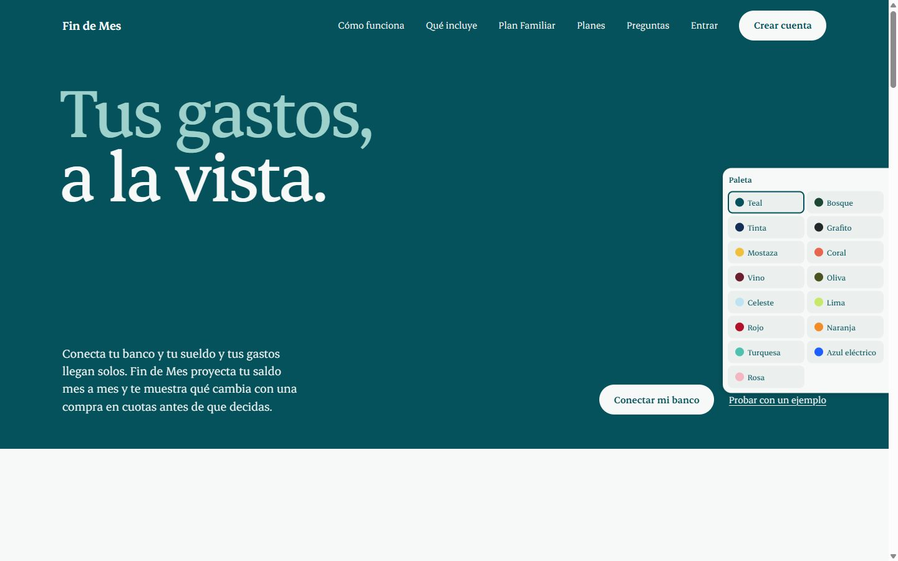
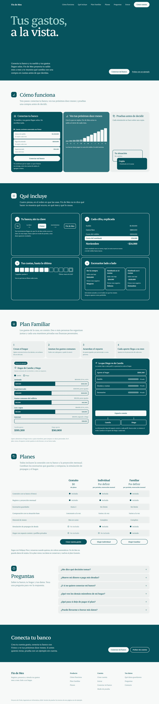
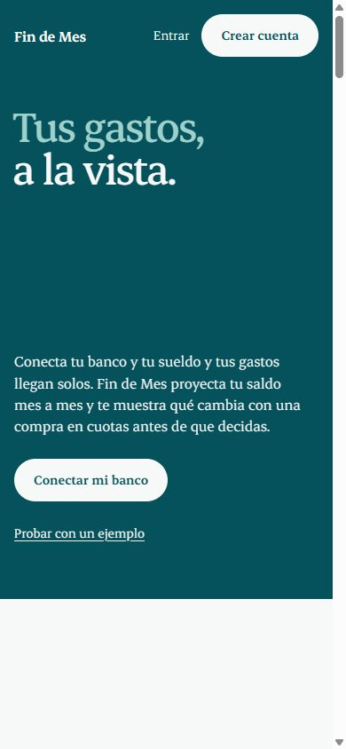
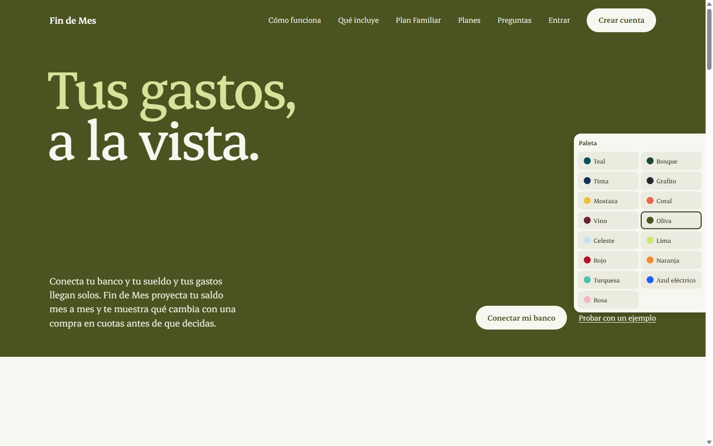

# Fin de Mes

Plataforma SaaS de registro y simulación financiera para personas y hogares en Chile. Reúne
ingresos, gastos, deudas y cuotas, proyecta el saldo mes a mes y muestra qué cambia con una
decisión (una compra en cuotas, un gasto nuevo, un prepago) antes de tomarla. El sistema describe
lo que ocurre y qué lo causa; no recomienda.

Proyecto de Título de Ingeniería en Informática. Equipo: Joaquín Varas (app Flutter y UX) y
Maximiliano Lizana (backend, motor, API y pagos).

## Landing (prototipo)

Versión de trabajo de la página pública: es la base sobre la que seguimos iterando. Es un solo
archivo HTML estático en [`prototype/landing/index.html`](prototype/landing/index.html).

La idea central es que la persona **conecte su banco** (Fintoc) para que su sueldo y sus gastos
lleguen solos; el registro manual queda como complemento para lo que el banco no entrega, como las
cuotas de tarjeta. Cada módulo explica su contenido con figuras hechas con datos de ejemplo, en vez
de bloques de texto.



<details>
<summary>Ver la página completa, la versión móvil y la paleta Oliva</summary>

| Página completa | Móvil |
|---|---|
|  |  |



</details>

**Secciones** (cada una con su ícono, título y una línea que dice de qué trata; el menú marca la
que se está leyendo):

| Sección | Qué muestra |
|---|---|
| Portada | «Tus gastos, a la vista.» y el botón principal «Conectar mi banco» |
| Cómo funciona | Tres pasos: conectas tu banco (movimientos que llegan solos), ves tus próximos doce meses (gráfico) y pruebas una compra sobre una copia |
| Qué incluye | Cuatro piezas numeradas en orden de uso: tu banco sin tu clave, cada cifra explicada, tus cuotas hasta la última y escenarios lado a lado (sin destacar ninguno) |
| Plan Familiar | Cuatro pasos, el reparto de gastos comunes en barras y lo que un integrante ve del otro (aporte visible, datos personales privados) |
| Planes | Gratuito, Individual y Familiar, en columnas iguales |
| Preguntas | Se abren al hacer clic, con animación |
| Cierre | «Conecta tu banco», con la opción de probar sin cuenta |

Esquinas redondeadas, contenido con ancho máximo de 1240 px y animaciones de entrada que respetan
la preferencia de movimiento reducido del sistema.

**Para verla en local** (Node 24):

```bash
node prototype/serve.mjs
# abrir http://localhost:4321/landing/index.html
```

**Paletas de prueba:** el selector del borde derecho cambia entre 15 combinaciones de color, todas
con contraste WCAG AA. La paleta elegida queda en la URL, por ejemplo
`http://localhost:4321/landing/index.html?paleta=oliva`. El selector es temporal: se quita cuando
se elija la paleta definitiva.

**Pendiente antes de publicarla:**
- Precios de los planes Individual y Familiar (hoy dicen «Por definir»).
- Los montos y el hogar de ejemplo son ficticios y están rotulados como «Datos de ejemplo».
- «Conectar mi banco» lleva al registro del prototipo; la conexión real usa el widget de Fintoc, hoy
  en modo de prueba, y los datos que entrega se rotulan como tales.
- Elegir la paleta definitiva y quitar el selector.

El prototipo navegable de la aplicación completa está en [`prototype/index.html`](prototype/index.html);
los enlaces de la landing («Conectar mi banco», «Crear cuenta», «Entrar», «Probar sin cuenta») apuntan a él.

## Estructura del repositorio

| Carpeta | Contenido |
|---|---|
| `backend/` | Motor de simulación (núcleo puro), módulos, adaptadores y API (Node.js + TypeScript) |
| `docs/` | OpenAPI, ADR, diagramas, diccionario de datos, KPI y SLA |
| `prototype/` | Prototipo navegable de la app y landing de prueba |
| `PRODUCT.md` | Contexto de producto: usuarios, propósito, principios y restricciones |

Las reglas del proyecto y los comandos de desarrollo están en [`CLAUDE.md`](CLAUDE.md); el stack
técnico, en [`docs/adr/001-technical-stack.md`](docs/adr/001-technical-stack.md).
